<p align="center">
  <a href="https://qalm.apollolearn.app"><picture><source media="(prefers-color-scheme: dark)" srcset="assets/brand/qalm-mark-dark.svg"></picture></a>
</p>

<h1 align="center">qalm</h1>
<p align="center"><sub>by Apollo</sub></p>

<p align="center">
  <a href="https://qalm.apollolearn.app"><picture><source media="(prefers-color-scheme: dark)" srcset="apps/site/public/showcase/hero-dark.png">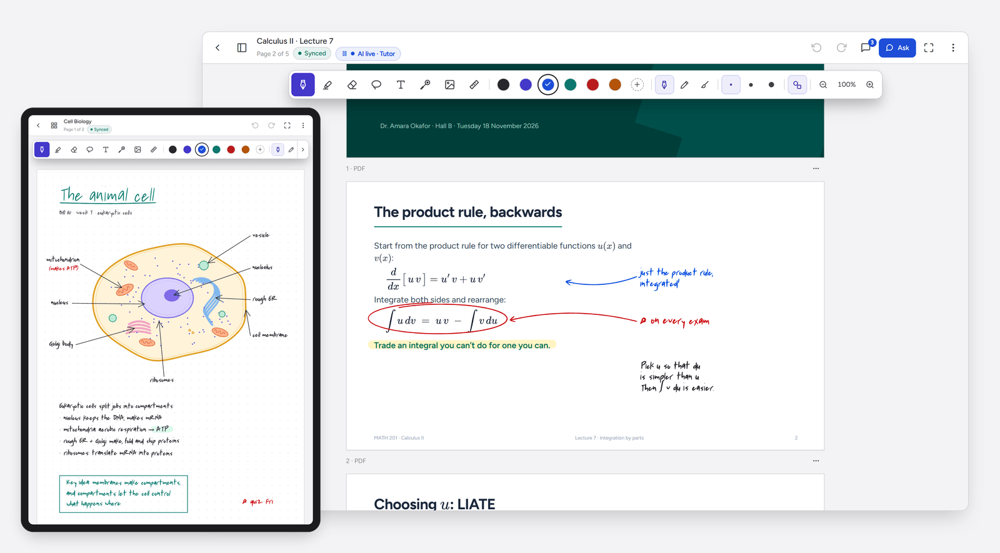</picture></a>
</p>

**Finally, a handwriting app that doesn't suck.** Ink that keeps up with your pen, palm rejection that actually works,
and pages that feel like paper. Free while in beta.

**[Open qalm in your browser](https://qalm.apollolearn.app/app/)** ·
[Download for Windows](https://qalm.apollolearn.app/download/windows) ·
[Download for Android](https://qalm.apollolearn.app/download/android) ·
[Website](https://qalm.apollolearn.app)

iPad and Mac are coming soon.

<table>
<tr>
<td width="50%" valign="top"><picture><source media="(prefers-color-scheme: dark)" srcset="apps/site/public/showcase/library-desktop-dark.png">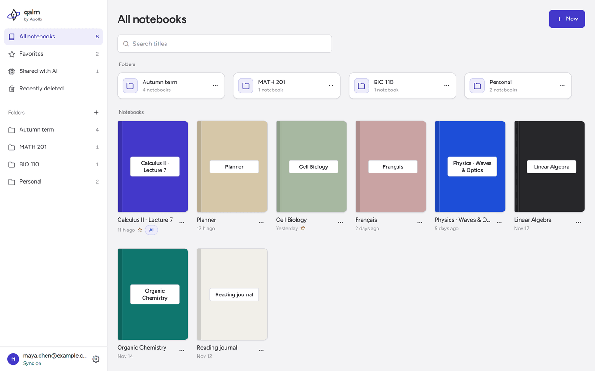</picture><br><sub>Your library: covers, folders, favourites</sub></td>
<td width="50%" valign="top"><picture><source media="(prefers-color-scheme: dark)" srcset="apps/site/public/showcase/pdf-desktop-dark.png">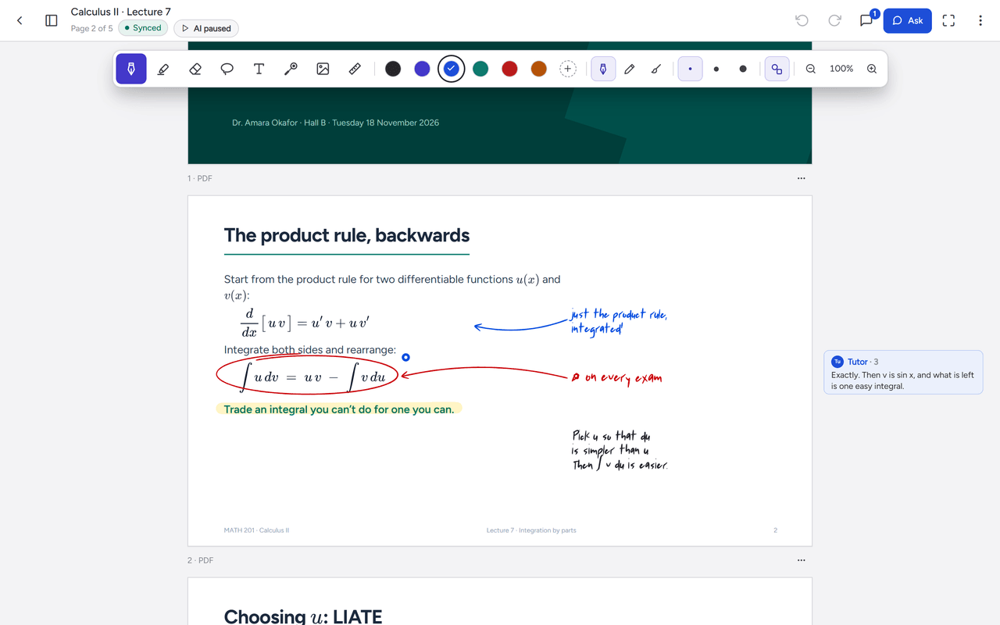</picture><br><sub>Write on imported PDFs</sub></td>
</tr>
<tr>
<td width="50%" valign="top"><picture><source media="(prefers-color-scheme: dark)" srcset="apps/site/public/showcase/image-tablet-dark.png">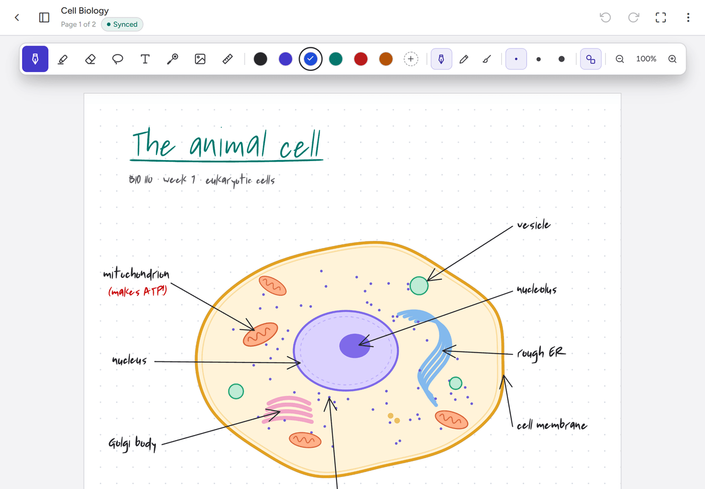</picture><br><sub>Images, labelled in ink with snapped shapes</sub></td>
<td width="50%" valign="top"><picture><source media="(prefers-color-scheme: dark)" srcset="apps/site/public/showcase/markdown-tablet-dark.png">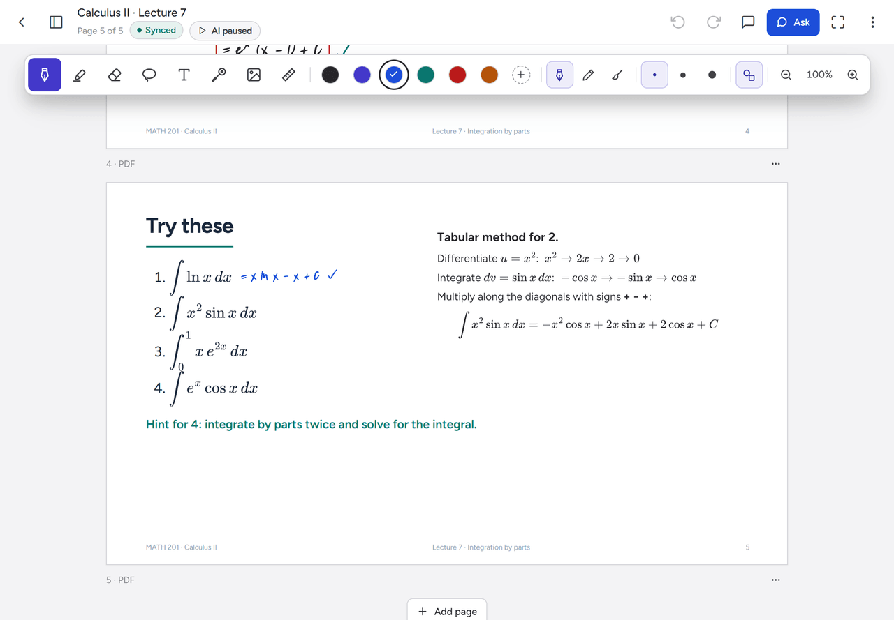</picture><br><sub>Text boxes with Markdown and maths</sub></td>
</tr>
</table>

<details>
<summary><b>More screenshots</b></summary>

<table>
<tr>
<td width="50%" valign="top"><picture><source media="(prefers-color-scheme: dark)" srcset="apps/site/public/showcase/lasso-tablet-dark.png">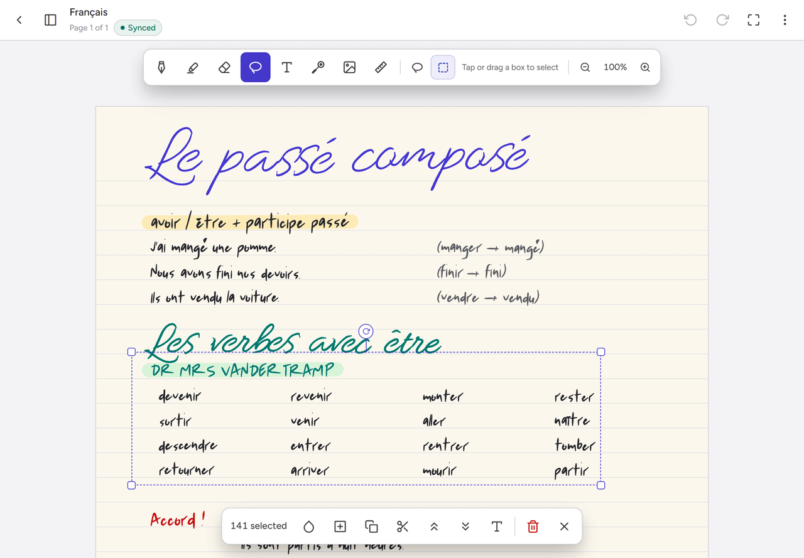</picture><br><sub>Lasso: move, resize, rotate, recolour</sub></td>
<td width="50%" valign="top"><picture><source media="(prefers-color-scheme: dark)" srcset="apps/site/public/showcase/navigator-tablet-dark.png">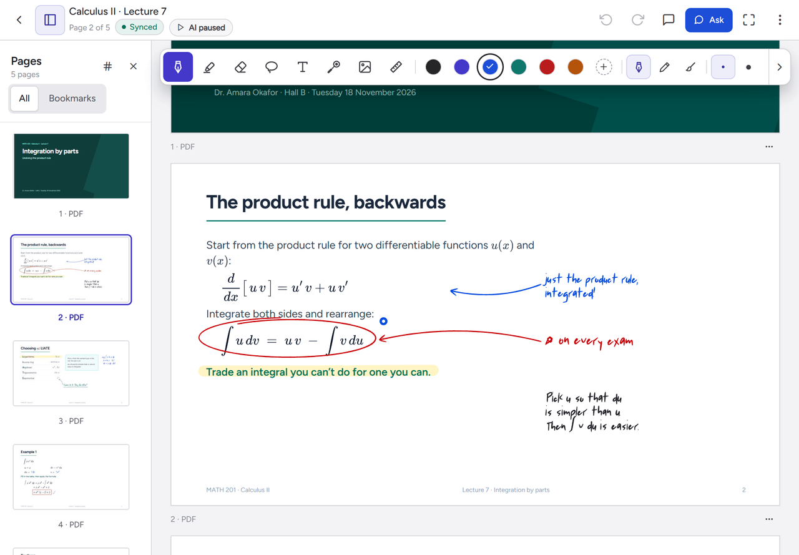</picture><br><sub>Page navigator with thumbnails</sub></td>
</tr>
<tr>
<td width="50%" valign="top"><picture><source media="(prefers-color-scheme: dark)" srcset="apps/site/public/showcase/lecture-desktop-dark.png">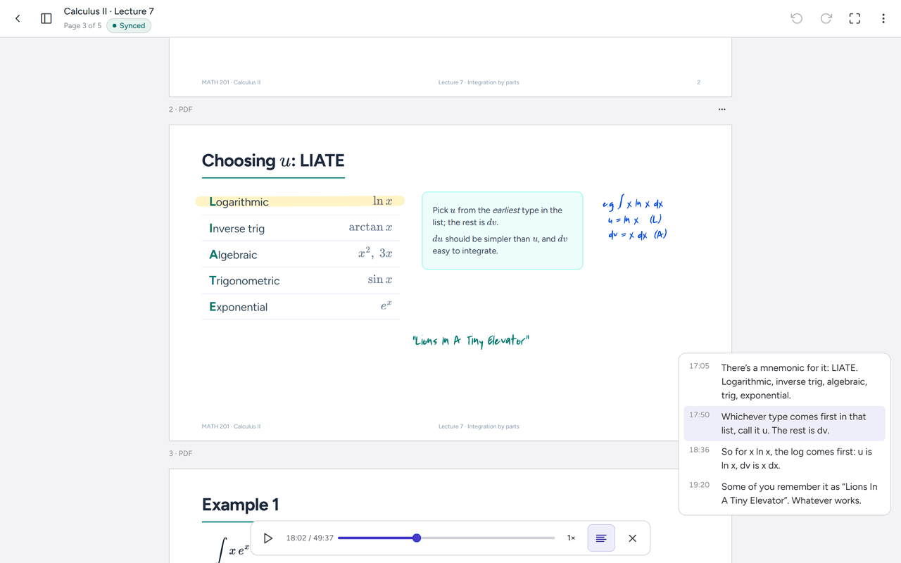</picture><br><sub>Lecture mode: replay your ink in time with the audio</sub></td>
<td width="50%" valign="top"><picture><source media="(prefers-color-scheme: dark)" srcset="apps/site/public/showcase/present-desktop-dark.png">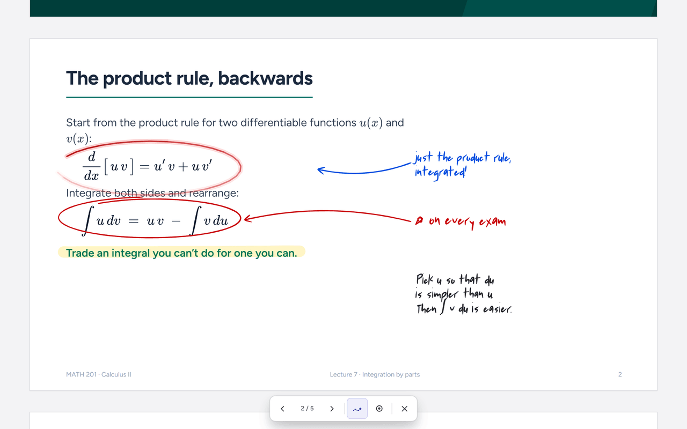</picture><br><sub>Present with a laser pointer</sub></td>
</tr>
<tr>
<td width="50%" valign="top"><picture><source media="(prefers-color-scheme: dark)" srcset="apps/site/public/showcase/ruler-tablet-dark.png">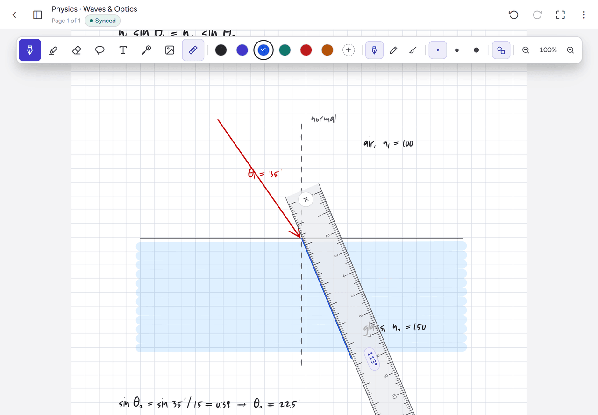</picture><br><sub>A ruler for straight lines at any angle</sub></td>
<td width="50%" valign="top"><picture><source media="(prefers-color-scheme: dark)" srcset="apps/site/public/showcase/planner-tablet-dark.png">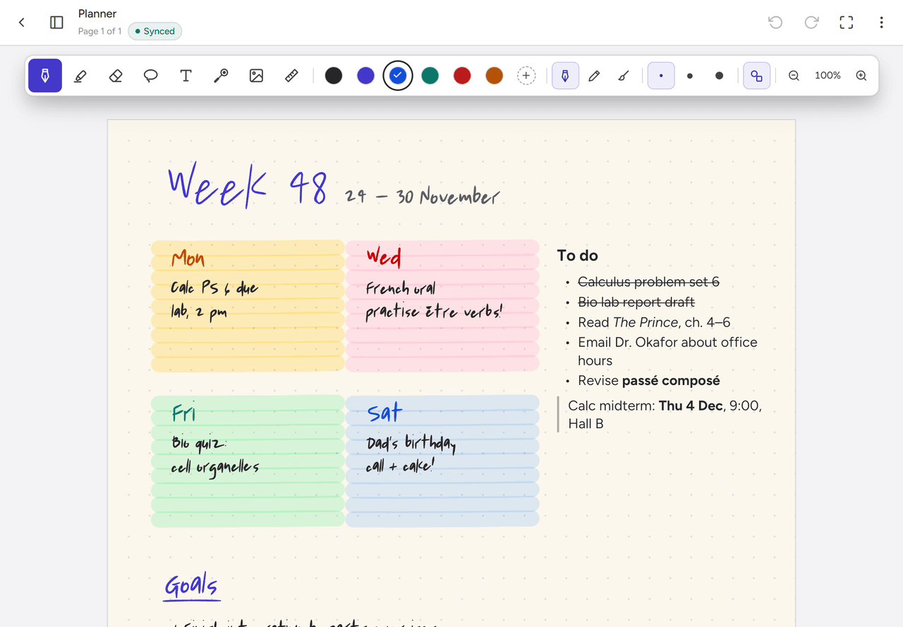</picture><br><sub>Highlighters, paper styles and covers</sub></td>
</tr>
</table>

</details>

<sub>Every screenshot is the real app, captured from generated demo notebooks: [apps/site/showcase](apps/site/showcase).</sub>

## Features

- **Low-latency ink.** The live stroke is drawn natively under the nib (predicted touches on iPad, a front-buffered
  renderer on Android, a desynchronized canvas on web and desktop), then handed to one Skia renderer for the page.
- **Palm rejection you can tune:** relaxed, standard or strict; a writing-hand side; a pen lockout; "pen only" so one
  finger scrolls and two zoom. A palm never moves the page.
- **Pens:** fountain, ball and brush styles, smoothing, pressure, hover preview, tilt shading, and the pen button or a
  double-tap for the eraser where your pen has them.
- **Tools:** pen, highlighter, eraser, lasso (move, resize, rotate, recolour, duplicate, delete, copy and paste), text
  boxes with Markdown and TeX maths, images, custom colours with synced swatches.
- **Shapes:** hold at the end of a stroke and it snaps into a line, arrow, rectangle, ellipse, triangle, diamond, star
  and more, live under the pen. Drag to adjust before you lift; one undo brings back your stroke.
- **PDFs:** import a PDF and write straight on it. Export any notebook to PDF, or to `.qalm` for a full backup.
- **Notebooks:** real pages, not one endless scroll. Paper styles and covers, a page navigator with thumbnails,
  bookmarks and reordering, folders, favourites, search and trash.
- **Sync:** an email sign-in (a link or a 6-digit code) and your notebooks sync across devices. Or skip the account and
  keep everything on this device.
- **Focus:** fullscreen with the panels tucked away (F11 on desktop), zoom, undo and redo, light and dark.

## Bring your own AI

qalm has no AI of its own. Instead, **your** agent (Claude, or any MCP client) can follow along as you write: it reads
your handwriting with its own vision, answers questions you ask on the page, and leaves comments next to your ink.
**It can never change your ink.** Access is per notebook and off by default.

<p align="center"><picture><source media="(prefers-color-scheme: dark)" srcset="apps/site/public/showcase/ai-desktop-dark.png">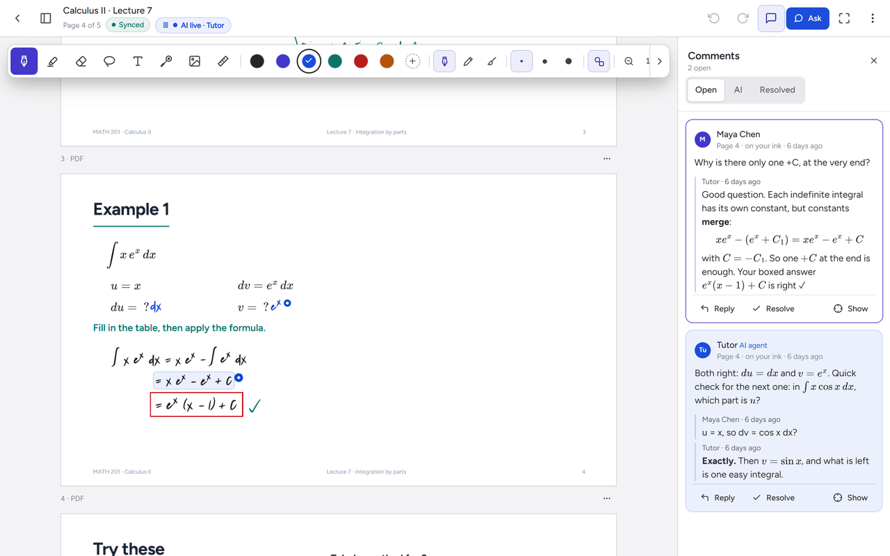</picture></p>

Connect in two steps:

1. Add qalm to your agent and approve it in the browser window that opens:

   ```bash
   claude mcp add --transport http qalm https://qalm-api.apollolearn.app/mcp
   ```

2. In qalm, open a notebook's menu and choose **Turn on AI access**. Settings → AI access shows connected agents,
   lets you choose whether each can comment or save readings, and lists what they did.

How the agent sees your page (regions of new ink, cropped and sent on a pause or when you tap **Ask**) is described in
[docs/qink-live.md](docs/qink-live.md).

---

## For developers

qalm is a pnpm monorepo in TypeScript.

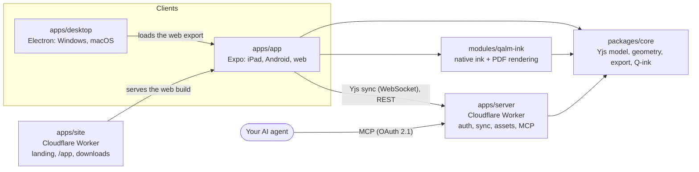

| Path | What it is |
|---|---|
| [`packages/core`](packages/core) | Shared TypeScript: the Yjs document model, geometry, rendering helpers, PDF and `.qalm` export, Q-ink encoding |
| [`modules/qalm-ink`](modules/qalm-ink) | Expo native module: the Skia page renderer, the low-latency ink overlay (Swift, Kotlin, web) and PDF page rendering |
| [`apps/app`](apps/app) | The Expo app (expo-router, React Native 0.88) for iPad, Android and the web |
| [`apps/desktop`](apps/desktop) | Electron shell that serves the app's web export on `app://qalm` |
| [`apps/server`](apps/server) | Cloudflare Worker: email sign-in, sync (Durable Objects), assets (R2), D1, MCP with OAuth |
| [`apps/site`](apps/site) | Cloudflare Worker for the website, the web app at `/app/` and the downloads |
| [`docs/`](docs/README.md) | Architecture, protocol, decisions, brand and design mockups |

### Quick start

You need Node 24 and pnpm (the version is pinned in `package.json`; `corepack enable` picks it up).

```bash
pnpm install
pnpm typecheck && pnpm test
```

Run the server locally (sign-in emails, including the 6-digit code, are printed to the console):

```bash
cp apps/server/.dev.vars.example apps/server/.dev.vars
pnpm --filter @qalm/server migrate:local
pnpm --filter @qalm/server dev            # http://127.0.0.1:8787
```

Run the web app against it (without a server URL the app works offline only):

```bash
EXPO_PUBLIC_QALM_SERVER_URL=http://127.0.0.1:8787 pnpm --filter @qalm/app web   # http://localhost:8081
```

Run the desktop app against the web dev server, or build it:

```bash
pnpm --filter @qalm/desktop dev           # Electron on the web dev server above (keep it running)
pnpm --filter @qalm/desktop dev:export    # or: Electron on a fresh web export, no dev server
pnpm --filter @qalm/desktop build         # web export + electron-builder -> apps/desktop/release/
```

On a fresh clone, if Electron's binary is missing, run `node node_modules/electron/install.js`.

### Tests

```bash
pnpm typecheck
pnpm --filter @qalm/core test       # also: @qalm/app, @qalm/server, @qalm/site, @qalm/desktop
pnpm --filter @qalm/desktop e2e     # end-to-end on a packaged build (Windows)
```

CI runs the typecheck and the core, app, server, site and desktop unit tests on every pull request.

### Building for Android and desktop

- **Android:** `pnpm --filter @qalm/app android`, or `npx expo prebuild -p android` in `apps/app` and build with
  Gradle. Release builds are signed with your own keystore through
  [`apps/app/plugins/with-release-signing.js`](apps/app/plugins/with-release-signing.js); without one they use the
  debug key.
- **iPad:** `pnpm --filter @qalm/app ios` on a Mac. The iOS code has not been compiled yet; help is welcome.
- **Windows and macOS:** `pnpm --filter @qalm/desktop dist` builds the installers with electron-builder.

Set `EXPO_PUBLIC_QALM_SERVER_URL` at build time to point a build at your server.

### Self-host the server on Cloudflare

The server and the website are Cloudflare Workers (Durable Objects, D1, R2 and KV). To run your own, create those
resources on your account, put their ids in `apps/server/wrangler.jsonc`, set the `JWT_SECRET` and `RESEND_API_KEY`
secrets, migrate and deploy, then build the clients with your server's URL. The step-by-step guide is in
[docs/development.md](docs/development.md#9-self-hosting-on-cloudflare).

### Docs

- [docs/development.md](docs/development.md): the development guide: run, test, build, self-host, known gaps
- [docs/README.md](docs/README.md): the index
- [docs/tech-spec.md](docs/tech-spec.md): architecture and the contracts between packages
- [docs/qink-live.md](docs/qink-live.md): the live format agents read, and the MCP tools
- [docs/decisions.md](docs/decisions.md): what's in v1 and what isn't

### Contributing

Issues and pull requests are welcome. Read [CONTRIBUTING.md](CONTRIBUTING.md) first, and open an issue before a big
change. Report security problems privately: see [SECURITY.md](SECURITY.md).

### License

The code is [MIT](LICENSE). The names "qalm" and "Apollo" and the logos are not covered by it: forks need their own
name and logo. See [TRADEMARKS.md](TRADEMARKS.md).
